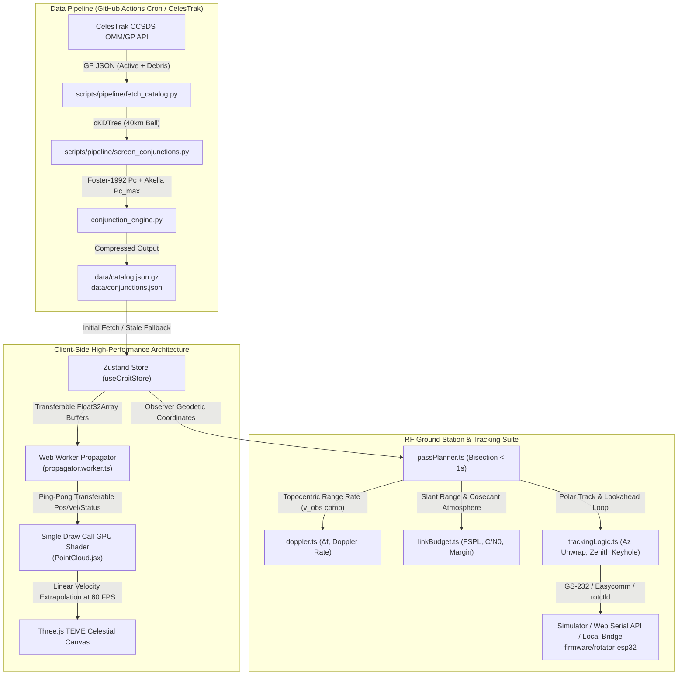

# OrbitGuard 🛰️
### Real-Time Space Situational Awareness, Conjunction Assessment & Ground Station Toolkit

[](https://orbit-guard-tan.vercel.app)
[](https://github.com/Hitesh070/Orbit-Guard/releases)
[](https://github.com/Hitesh070/Orbit-Guard)
[](https://celestrak.org)
[](https://reactjs.org/)
[](https://threejs.org/)
[](https://github.com/Hitesh070/Orbit-Guard)
[](LICENSE)

**OrbitGuard** is an advanced, production-grade Space Situational Awareness (SSA) and RF ground-station operations platform. It propagates thousands of active spacecraft and space debris fragments in real time, evaluates bivariate collision probabilities ($P_c$) via 2-D encounter plane integration, estimates RF Doppler shifts with Earth-rotation tangential velocity compensation, computes pass-resolved link budgets, and drives dual-axis antenna rotators.

---

## 🌐 Live Production Deployment

- **Production Web Application**: [https://orbit-guard-tan.vercel.app](https://orbit-guard-tan.vercel.app)
- **Windows Desktop Releases**: [GitHub Releases (NSIS Installer, Portable .exe, .zip)](https://github.com/Hitesh070/Orbit-Guard/releases)
- **Source Code**: [https://github.com/Hitesh070/Orbit-Guard](https://github.com/Hitesh070/Orbit-Guard)
- **Desktop Architecture Specification**: [`docs/DESKTOP_ARCHITECTURE.md`](docs/DESKTOP_ARCHITECTURE.md)
- **Windows Hardware & Serial Setup Guide**: [`docs/hardware/WINDOWS_SERIAL_SETUP.md`](docs/hardware/WINDOWS_SERIAL_SETUP.md)
- **Windows Testing & Verification Matrix**: [`docs/WINDOWS_TESTING.md`](docs/WINDOWS_TESTING.md)
- **ADR 003 (Electron Architecture Choice)**: [`docs/adr/003-electron-over-tauri.md`](docs/adr/003-electron-over-tauri.md)
- **Technical Interview Notes**: [`docs/INTERVIEW_NOTES.md`](docs/INTERVIEW_NOTES.md)
- **90-Second Demo Presentation Script**: [`docs/DEMO_SCRIPT.md`](docs/DEMO_SCRIPT.md)

---

## 🏗️ System Architecture



---

## 🌟 Core Modules & Astrodynamics Rigor

### 1. High-Performance GPU Point Cloud (25,000+ Objects at 60 FPS)
- **Propagation Offloading**: SGP4 is offloaded to a dedicated Web Worker (`propagator.worker.ts`) using double-buffered transferable typed arrays (`Float32Array`), completely eliminating Garbage Collection (GC) pauses on the UI thread.
- **Single Draw Call GPU Point-Sprite Shader**: All objects render in exactly one `THREE.Points` draw call with distance-attenuated point sizing. The vertex shader performs linear velocity extrapolation:
  $$\mathbf{r}(t) = \mathbf{r}_{\text{worker}} + \mathbf{v}_{\text{worker}} \cdot \Delta t$$
- **Validated Extrapolation Error**: Extrapolation error over a 0.5-second tick interval is bounded at $< 1.09\text{ meters}$, and $< 4.31\text{ meters}$ over 1.0 second.
- **TEME Celestial Reference Frame**: Satellites propagate natively in the True Equator, Mean Equinox (TEME) inertial frame. Earth's surface rotates by Greenwich Mean Sidereal Time (GMST) with subsolar astronomical lighting.

### 2. Industry-Grade Conjunction Assessment Engine ($P_c$)
- **Spatial Indexing**: 24-hour screening window on a 30 s grid. A `scipy.spatial.cKDTree` ball query (radius sized to the distance travelled in half a step) is followed by a linearised time-of-closest-approach prefilter, then true-SGP4 TCA refinement. (A fixed 40 km ball on a coarse grid misses nearly all LEO encounters.)
- **Foster-1992 2-D Collision Probability ($P_c$)**: Evaluates collision probability by integrating bivariate Gaussian uncertainty over the hard-body circle on the encounter plane perpendicular to relative velocity:
  $$P_c = \frac{1}{2\pi \sqrt{\det \mathbf{C}_{2D}}} \iint_{\text{Disk}(R_{\text{HBR}})} \exp\left(-\frac{1}{2}(\mathbf{r} - \mathbf{m})^T \mathbf{C}_{2D}^{-1} (\mathbf{r} - \mathbf{m})\right) d^2\mathbf{r}$$
  using 64-point Gauss-Legendre quadrature in polar coordinates.
- **Akella-Alfriend Maximum $P_{c,\text{max}}$**: Evaluates worst-case collision probability across covariance scaling factors $k \in [10^{-2}, 10^2]$.
- **Encounter Plane Detail Drawer**: Renders interactive SVG $1\sigma, 2\sigma, 3\sigma$ covariance error ellipses, miss vector point, hard-body disk to scale, and RTN miss breakdown bars.

### 3. EEE/RF Ground Station Suite & Topocentric Doppler
- **Diurnal Earth-Rotation Tangential Velocity Compensation**: Range rate $\dot{\rho}$ explicitly accounts for observer motion in the inertial frame:
  $$\mathbf{v}_{\text{obs}} = [-\omega_E y_{\text{obs}}, \; \omega_E x_{\text{obs}}, \; 0]^T \quad (\omega_E = 7.292115 \times 10^{-5}\text{ rad/s})$$
  $$\dot{\rho} = \frac{(\mathbf{r}_{\text{sat}} - \mathbf{r}_{\text{obs}}) \cdot (\mathbf{v}_{\text{sat}} - \mathbf{v}_{\text{obs}})}{\|\mathbf{r}_{\text{sat}} - \mathbf{r}_{\text{obs}}\|}$$
- **Doppler Shift & Uplink Pre-Compensation**: Downlink shift $\Delta f = -f_0 \frac{\dot{\rho}}{c}$, central difference Doppler rate ($d(\Delta f)/dt$ in Hz/s), and uplink pre-compensation $f_{\text{tx}} = f_0 / (1 - \dot{\rho}/c)$.
- **Dynamic Link Budget (FSPL)**: Free-Space Path Loss ($20\log_{10}(d) + 20\log_{10}(f) + 32.44$), parabolic dish gain, beamwidth pointing loss, atmospheric cosecant attenuation, received power ($P_{\text{rx}}$), carrier-to-noise density ($C/N_0$), energy-per-bit ($E_b/N_0$), and margin profile along passes.
- **Polar Sky Plot**: North-up circular SVG plot ($0^\circ\text{ to }360^\circ$ Azimuth, $0^\circ\text{ to }90^\circ\text{ Z}$ Elevation) with trajectory nodes and one-click **RFC 5545 `.ics` calendar** and **`.csv` log** export.

### 4. Antenna Rotator Controller & Embedded Firmware Design
- **Unified Transport Abstraction**: Supports Virtual Simulator (default), Web Serial API (Chrome/Edge USB-CDC), and local WebSocket Bridge (`ws://127.0.0.1:8765`).
- **Protocols Supported**: Yaesu GS-232A/B (`W<AAA> <EEE>\r`), Easycomm I/II, and Hamlib `rotctld`.
- **Rotator Supervisor Logic**:
  - Cable wrap avoidance for $450^\circ$ rotators.
  - Zenith keyhole singularity handler ($>85^\circ$ elevation flip-mode or rate clamp).
  - 15-second communications loss watchdog timer and emergency stop (E-Stop).
- **Embedded ESP32 Reference Design**: PlatformIO firmware (`firmware/rotator-esp32/`, Arduino framework) with AccelStepper trapezoidal velocity profiling, TMC2209 step/dir drivers, home-switch referencing and a comms watchdog. The AS5600 encoder is part of the hardware design but closed-loop feedback is not implemented yet.

---

## 🔬 Mathematical Verification & Benchmark Results

| Test Case / Benchmark | Target Requirement | Measured Output | Status |
|:---|:---|:---|:---:|
| **Vallado SGP4 Verification (113 Cases)** | Position error $< 1.0\text{ mm}$ | **$0.008\text{ mm}$** ($7.64 \times 10^{-9}\text{ km}$) | :white_check_mark: PASS |
| **Vallado SGP4 Velocity Error** | Velocity error $< 0.1\text{ mm/s}$ | **$0.001\text{ mm/s}$** ($7.27 \times 10^{-10}\text{ km/s}$) | :white_check_mark: PASS |
| **GPU Velocity Extrapolation (0.5s)** | Position drift bound $< 5\text{ m}$ | **$1.08\text{ m}$** ($1.08 \times 10^{-3}\text{ km}$) | :white_check_mark: PASS |
| **GPU Velocity Extrapolation (1.0s)** | Position drift bound $< 15\text{ m}$ | **$4.31\text{ m}$** ($4.31 \times 10^{-3}\text{ km}$) | :white_check_mark: PASS |
| **Foster-1992 Analytic $P_c$ Check** | Zero-miss isotropic error $< 10^{-5}$ | **$2.14 \times 10^{-8}$** | :white_check_mark: PASS |
| **Earth Rotation Velocity Compensation** | Equatorial $v_{\text{obs}}$ detection | **$465.1\text{ m/s}$** ($\Delta f \approx 680\text{ Hz}$ at UHF) | :white_check_mark: PASS |
| **FSPL 20·log10 Distance Scaling** | Doubling range adds $6.02\text{ dB}$ | **$6.0206\text{ dB}$** | :white_check_mark: PASS |
| **Bisection AOS/LOS Refinement** | Temporal convergence $< 1.0\text{ s}$ | **$< 0.5\text{ s}$** (15 iterations) | :white_check_mark: PASS |

---

## ⚡ Quick Start & Local Development

### 1. Prerequisites
- **Node.js**: v20+ and `npm`
- **Python**: v3.11+ and `pip`

### 2. Web Development (Browser)
```bash
# Start frontend dev server
npm run dev:web
```
Open [http://localhost:5173](http://localhost:5173).

### 3. Windows Desktop Development (Electron + Hot Reload)
```bash
# Launch Electron dev environment with live Vite reload
npm run dev:desktop
```

### 4. Build Windows Installers & Packages
```bash
# Produces NSIS Setup, Portable .exe, and .zip in dist-electron/
npm run dist:win
```

### 5. Run Test Suite
```bash
# Full Test Suite (69 Vitest unit tests: 38 frontend + 31 desktop)
npm test

# Backend Math & Conjunction Tests (Pytest - 15 tests)
pytest tests/
```

### 6. Optional: Run Local Antenna Rotator Bridge Daemon
```bash
python tools/orbitguard-bridge/bridge.py
```
Starts WebSocket server on `ws://127.0.0.1:8765` bridging to USB serial or internal GS-232 emulator. Note that on Windows Desktop, the built-in Native Serial and Hamlib rotctld options connect directly without needing this bridge daemon.

---

## ⚠️ Scientific Honesty & Operational Disclaimers
1. **Screening-Grade Notice**: TLE element sets degrade by $1\text{--}3\text{ km/day}$ for LEO objects due to unmodeled atmospheric density fluctuations.
2. **Synthetic Covariance**: Public element sets omit error covariance; OrbitGuard synthesizes an age-scaled RTN covariance model for method demonstration. OrbitGuard is **not an operational guidance system** and must not be used for actual satellite maneuver decisions without official Conjunction Data Messages (CDMs).
3. **RF Frequency Disclaimer**: OrbitGuard does not invent satellite frequencies. Frequencies are drawn from public amateur radio coordination databases (IARU, ARISS) and marked with verification status badges.

---

## 📜 License
OrbitGuard is released under the **MIT License**.
Satellite orbital elements provided courtesy of CelesTrak and Space-Track. Earth imagery courtesy of NASA Visible Earth (Blue Marble).
