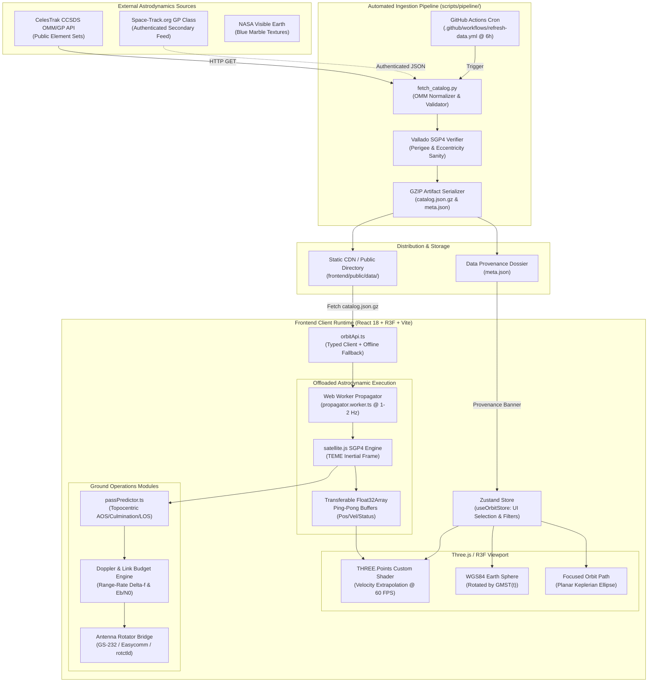

# OrbitGuard System Architecture & Astrodynamics Pipeline

## 1. System Topology Overview

OrbitGuard is structured as an end-to-end Space Situational Awareness (SSA) system that decouples scheduled heavy astrodynamic ingestion from low-latency interactive client rendering.

---

## 2. Component Architecture Breakdown

### 2.1 Data Pipeline (Offline / GitHub Actions)
* **Location:** `scripts/pipeline/fetch_catalog.py`
* **Trigger:** Scheduled cron (`0 */6 * * *`) via GitHub Actions plus manual `workflow_dispatch`.
* **Execution:**
  1. Ingests normalized OMM JSON sets across operational satellite regimes and debris fields (Cosmos-2251, Iridium-33, Fengyun-1C).
  2. Runs physical validation: flags decayed objects ($r_p < -200\text{ km}$, $e \ge 1$), calculates TLE age in days, and tags stale elements ($>14\text{ days}$).
  3. Emits compressed artifacts: `catalog.json.gz` (456 KB) and provenance metadata `meta.json`.

### 2.2 Client-Side Astrodynamic Engine
* **Location:** `src/workers/propagator.worker.ts` & `src/utils/sgp4Engine.ts`
* **Coordinate Frame:** True Equator, Mean Equinox (TEME), native Earth-Centered Inertial (ECI).
* **Buffer Architecture:**
  - Memory is allocated upfront using contiguous typed arrays (`Float32Array(3 * N)` for positions, `Float32Array(3 * N)` for velocities, `Uint8Array(N)` for status/regime).
  - Uses zero-copy transferable objects to ping-pong data between worker and main thread without garbage collection overhead.

### 2.3 Graphical Rendering Engine
* **Technology:** Three.js / React Three Fiber with custom GLSL ShaderMaterial.
* **Draw Call Count:** Exactly **1 draw call** for 25,000+ points (`THREE.Points`).
* **Velocity Extrapolation:**
  $$\mathbf{r}(t) = \mathbf{r}_0 + \mathbf{v}_0 \cdot \Delta t$$
  The vertex shader extrapolates positions in real time at 60 FPS while SGP4 runs asynchronously at 1–2 Hz in the worker.
* **Earth Rotation:** The 3D Earth mesh rotates according to Greenwich Mean Sidereal Time ($\theta_{\text{GMST}}$):
  $$\theta_{\text{Earth}} = \text{GMST}(t)$$
  This maintains physical accuracy, avoids per-point trigonometric conversions, and renders planar, closed orbital ellipses.

---

## 3. Reference Frame Conversions

| Source Frame | Target Frame | Mathematical Operation | Purpose |
| :--- | :--- | :--- | :--- |
| **TEME** | **ECEF** | Rotation by Greenwich Mean Sidereal Time $\mathbf{R}_z(\theta_{\text{GMST}})$ | Ground subpoints (lat/lon/alt) |
| **ECEF** | **Topocentric SEZ** | Coordinate transformation via observer geodetic position $(\phi, \lambda, h)$ | Look angles (Azimuth, Elevation, Slant Range) |
| **ECI** | **Encounter Plane (B-Plane)** | Projection perpendicular to relative velocity vector $\mathbf{v}_{\text{rel}}$ | 2-D Conjunction Assessment & Foster $P_c$ |
| **ECI** | **RTN** | Basis: $\hat{\mathbf{r}}=\mathbf{r}/\|\mathbf{r}\|$, $\hat{\mathbf{n}}=(\mathbf{r}\times\mathbf{v})/\|\mathbf{r}\times\mathbf{v}\|$, $\hat{\mathbf{t}}=\hat{\mathbf{n}}\times\hat{\mathbf{r}}$ | Orbital uncertainty & covariance propagation |
