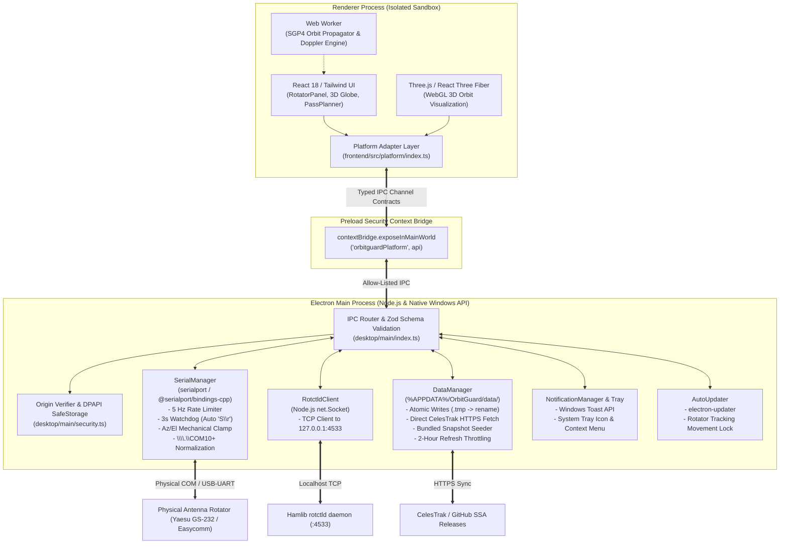

# OrbitGuard Desktop Architecture Specification

## Overview

OrbitGuard is engineered as a unified, single-codebase application supporting both modern web browsers (deployed via Vercel) and native Windows desktop environments (powered by Electron).

When launched as a native desktop application, OrbitGuard activates hardware-interfacing capabilities not permitted inside browser sandboxes:
- **Direct Serial (COM Port) Communication**: Interfaces with Yaesu GS-232 and Easycomm antenna rotators with zero external bridge software.
- **Hamlib TCP rotctld**: High-speed local TCP socket (`127.0.0.1:4533`) for amateur radio rotator control.
- **Offline-First Data Layer**: Local atomic caching in `%APPDATA%/OrbitGuard/data/` with direct CelesTrak OMM/GP API fetching and bundled fallback snapshots.
- **Windows Toast Notifications**: System tray integration and background pass reminders for favorite tracked satellites.
- **Hardware Safety Supervision**: Hardware rate limiting (max 5 Hz), physical angle clamping ($0^\circ\text{--}450^\circ$ Az, $0^\circ\text{--}180^\circ$ El), and a 3-second motor freeze watchdog in the Electron Main process.

---

## Architectural Diagram

---

## Security Model

The OrbitGuard desktop application enforces an uncompromising defense-in-depth security model:

1. **Context Isolation & Sandboxing**:
   - `contextIsolation: true`
   - `sandbox: true`
   - `nodeIntegration: false`
   - `webSecurity: true`
   The Renderer process has zero direct access to Node.js `fs`, `net`, `child_process`, or native addons.

2. **Allow-Listed IPC with Strict Zod Validation**:
   - Every IPC invocation across channels (`serial:open`, `serial:write`, `rotctld:connect`, `data:refresh`, etc.) is validated at runtime against strict Zod schemas before being processed by the Main process.
   - Malformed payloads, oversized strings, or unexpected properties are immediately rejected.

3. **Origin & Navigation Verification**:
   - IPC events verify `event.senderFrame.url` matches the trusted `app://` or local dev origin.
   - `will-navigate` and `setWindowOpenHandler` block any navigation to external URLs and delegate trusted links to the OS default browser via `shell.openExternal`.

4. **Credential Security**:
   - Sensitive credentials and keys are encrypted at rest using the Windows Data Protection API (DPAPI) via Electron's `safeStorage`.

5. **Strict Content Security Policy (CSP)**:
   - Scripts and styles are locked down to self and inline hashes, disallowing eval or remote script injection.

---

## Hardware Safety & Rotator Supervision

Antenna rotators carry substantial physical mass and high gear torque. OrbitGuard enforces triple-layer hardware safety directly in the Main process:

- **Command Rate Limiting**: The Main process throttles commands to a maximum of 5 Hz (150 ms minimum interval). Rapid position updates from high-framerate UI interpolations are dropped or queued to protect motor controller microcontrollers from FIFO overruns.
- **Mechanical Limit Clamping**: Azimuth is clamped between $0^\circ$ and $450^\circ$ (for extended-rotation Yaesu rotators) and Elevation is clamped between $0^\circ$ and $180^\circ$ (flip mode) or $90^\circ$ (standard).
- **3-Second Deadman Watchdog**: If the renderer crashes, freezes, or communication stops during active tracking, the Main process watchdog detects the inactivity after 3 seconds and automatically transmits the emergency stop command (`S\r` / `VE\n`) to halt rotation immediately.
