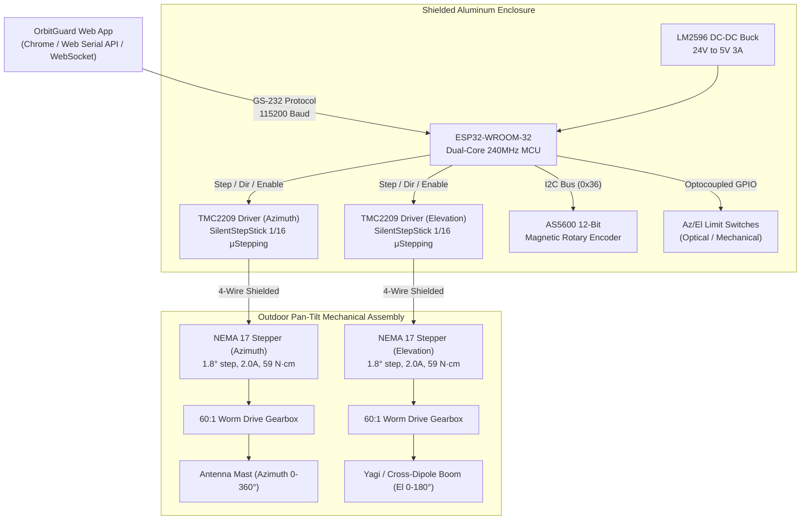

# OrbitGuard Antenna Rotator Embedded Hardware Reference Design (Phase 5)

## 1. System Architecture

---

## 2. Electrical Wiring & Pin Map

| ESP32 GPIO | Function | Peripheral | Description |
|:---|:---|:---|:---|
| **GPIO 19** | `AZ_STEP` | TMC2209 Azimuth | Step pulse (active rising edge) |
| **GPIO 18** | `AZ_DIR` | TMC2209 Azimuth | Direction (HIGH = Clockwise, LOW = CCW) |
| **GPIO 5** | `AZ_EN` | TMC2209 Azimuth | Motor power stage enable (Active LOW) |
| **GPIO 17** | `EL_STEP` | TMC2209 Elevation | Step pulse (active rising edge) |
| **GPIO 16** | `EL_DIR` | TMC2209 Elevation | Direction (HIGH = Up, LOW = Down) |
| **GPIO 4** | `EL_EN` | TMC2209 Elevation | Motor power stage enable (Active LOW) |
| **GPIO 25** | `AZ_HOME` | Microswitch | Azimuth mechanical home limit switch (Pullup) |
| **GPIO 26** | `EL_HOME` | Microswitch | Elevation mechanical horizon stop (Pullup) |
| **GPIO 21** | `I2C_SDA` | AS5600 Encoder | 12-bit absolute position magnetic feedback |
| **GPIO 22** | `I2C_SCL` | AS5600 Encoder | I2C Clock (400 kHz) |

---

## 3. Kinematic Steps-per-Degree Calculation

$$\text{Motor Resolution} = \frac{360^\circ}{1.8^\circ} = 200 \text{ full steps per revolution}$$

$$\text{Microstepping Resolution} = 16 \text{ microsteps per full step} \implies 200 \times 16 = 3,200 \text{ microsteps/rev}$$

$$\text{Gearbox Ratio} = 60:1 \text{ reduction (Worm drive)}$$

$$\text{Total Output Pulses/Rev} = 3,200 \times 60 = 192,000 \text{ steps per 360}^\circ$$

$$\text{Steps per Degree} = \frac{192,000}{360} = 533.3333 \text{ steps/degree}$$

- **Backlash Compensation**: For standard worm gear sets, a backlash deadband constant of $0.2^\circ$ (106 steps) is compensated in firmware when reversing direction.

---

## 4. Power Supply & Thermal Budget

| Component | Operating Voltage | Peak Current | Continuous Current | Peak Power |
|:---|:---|:---|:---|:---|
| **Azimuth Stepper Motor** | 24V DC | 1.8 A | 1.2 A | 43.2 W |
| **Elevation Stepper Motor** | 24V DC | 1.8 A | 1.2 A | 43.2 W |
| **ESP32 MCU + Logic** | 5V DC (Buck) | 250 mA | 120 mA | 1.25 W |
| **Total System Load** | **24V DC** | **~3.7 A** | **~2.5 A** | **~88 W** |

**Recommended Power Supply**: 24V DC, 6.5A (150W) Mean Well LRS-150-24 enclosed switching supply.

---

## 5. EMI Shielding & RF Grounding for Ground Stations

1. **Star Grounding**: Connect the ESP32 logic ground, motor power ground, and shielded cable braids to a single common central brass grounding stud connected to station Earth ground.
2. **Ferrite Chokes**: Clamp Type 43/31 ferrite cores over both ends of the stepper motor lead cables to prevent PWM switching harmonics from degrading VHF/UHF receiver sensitivity.
3. **Optoisolation**: Limit switch and serial USB interfaces should run through optocouplers (PC817 / 6N137) to prevent ground loops between the tracking PC and the rotator mast.

---

## 6. Bill of Materials (BOM)

| Item | Component | Quantity | Approximate Cost (INR) |
|:---|:---|:---|:---|
| 1 | ESP32-WROOM-32 Development Board | 1 | ₹450 |
| 2 | TMC2209 v3.0 SilentStepStick Stepper Drivers | 2 | ₹900 |
| 3 | NEMA 17 High Torque Stepper Motors (59 N·cm) | 2 | ₹1,800 |
| 4 | 60:1 Worm Gearbox Pan-Tilt Assembly | 1 | ₹4,500 |
| 5 | Mean Well LRS-150-24 (24V 6.5A Power Supply) | 1 | ₹1,650 |
| 6 | AS5600 12-Bit Magnetic Angle Sensors | 2 | ₹400 |
| 7 | Die-cast Weatherproof Aluminum Enclosure (IP66) | 1 | ₹1,200 |
| 8 | Shielded 4-core AWG20 Motor Cables (10m) | 2 | ₹800 |
| **Total** | **Complete Dual-Axis Ground Station Hardware** | | **₹11,500 (~$135)** |
